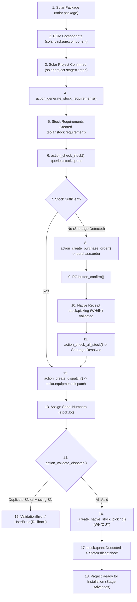
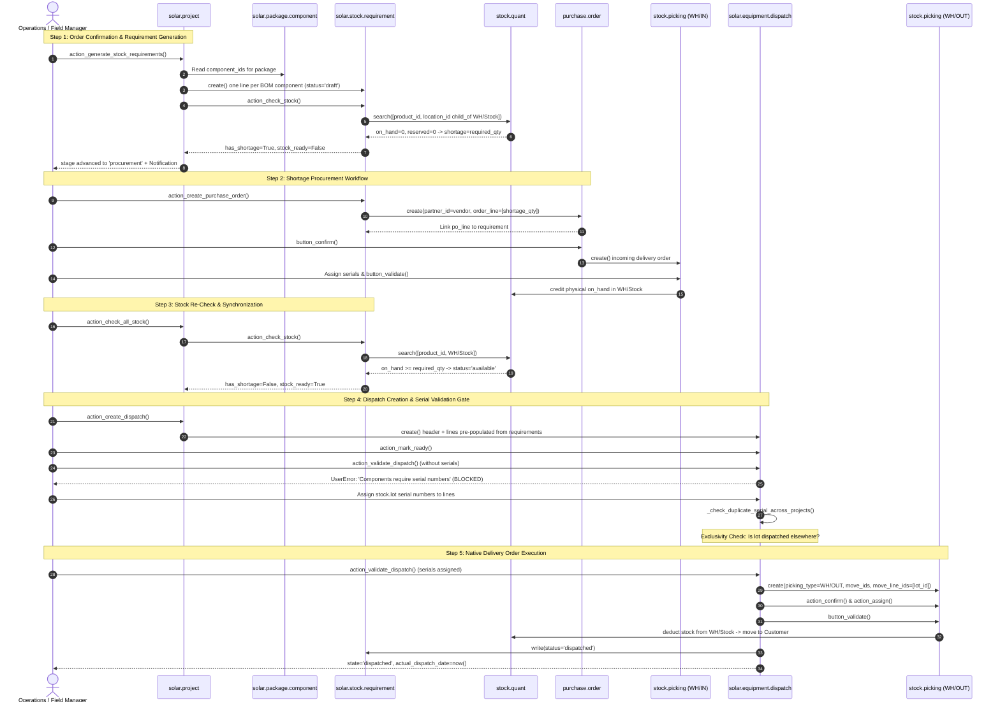

# Phase 4: Stock & Procurement — End-to-End Execution Flow Walkthrough

This document traces the complete execution lifecycle of **Phase 4: Stock & Procurement Management** in Project SunFlow, detailing every database transition, method invocation, and Odoo model interaction.

---

## 1. High-Level Architecture Flowchart

---

## 2. Comprehensive Mermaid Sequence Diagram

---

## 3. Detailed Step-by-Step Execution Walkthrough

### Phase 4.1: Solar Package & BOM Definition
- **Files Responsible**: [`package_bom.py`](file:///k:/Projects/solarops-odoo/odoo_addons/sunflow_core/models/package_bom.py), [`solar_package_ext.py`](file:///k:/Projects/solarops-odoo/odoo_addons/sunflow_core/models/solar_package_ext.py).
- **Execution**:
  1. An inventory manager creates a `solar.package` (e.g. `SunFlow 5kW Hybrid Smart Storage Package`, 5 kW capacity, base price \$320,000).
  2. The manager configures `solar.package.component` lines:
     - 10x Mono PERC 550W Panels (`is_serialized=False`)
     - 1x SunFlow 5kW Hybrid Inverter (`is_serialized=True`)
     - 1x SunFlow 5kWh LiFePO4 Battery (`is_serialized=True`)
  3. Method `_check_quantity_positive()` verifies all quantities $> 0$.
  4. Computed field `component_count` updates to `3` and persists to PostgreSQL.

---

### Phase 4.2: Commercial Confirmation & Requirement Generation
- **Files Responsible**: [`solar_package_ext.py`](file:///k:/Projects/solarops-odoo/odoo_addons/sunflow_core/models/solar_package_ext.py#L120-L178), [`stock_requirement.py`](file:///k:/Projects/solarops-odoo/odoo_addons/sunflow_core/models/stock_requirement.py#L140-L182).
- **Execution**:
  1. Customer signs contract; `solar.project` moves to `stage='order'`.
  2. User clicks **"Generate Stock Requirements"** (`action_generate_stock_requirements`).
  3. Validation checks: verifies `package_id` exists and has BOM components.
  4. Deletes prior `draft` requirements to prevent duplicate accumulation.
  5. Iterates through `package_id.component_ids` and creates 3 `solar.stock.requirement` records.
  6. Automatically invokes `self.stock_requirement_ids.action_check_stock()`.
  7. If project is in `'order'` stage, it advances to `'procurement'`.

---

### Phase 4.3: Availability Calculation & Shortage Detection
- **Files Responsible**: [`stock_requirement.py`](file:///k:/Projects/solarops-odoo/odoo_addons/sunflow_core/models/stock_requirement.py#L115-L182).
- **Execution**:
  1. `action_check_stock()` resolves the active company's warehouse (`wh = YourCompany`, `lot_stock_id = WH/Stock`).
  2. Executes `stock.quant.search([('product_id', '=', product.id), ('location_id', 'child_of', lot_stock_id.id)])`.
  3. Computes `on_hand = sum(quants.quantity)` and `reserved = sum(quants.reserved_quantity)`.
  4. Queries incoming confirmed PO lines via `_get_incoming_qty()`.
  5. Computes:
     $$\text{qty\_available} = \max(0.0, \text{qty\_on\_hand} - \text{qty\_reserved})$$
     $$\text{qty\_shortage} = \max(0.0, \text{required\_qty} - \text{qty\_available})$$
  6. Sets `status = 'shortage'`, `has_shortage = True`.
  7. On the project, computed field `has_shortage = True` activates the red shortage alert banner in Odoo web UI.

---

### Phase 4.4: Procurement Workflow (Shortage to PO)
- **Files Responsible**: [`stock_requirement.py`](file:///k:/Projects/solarops-odoo/odoo_addons/sunflow_core/models/stock_requirement.py#L194-L228).
- **Execution**:
  1. Inventory manager clicks **"Buy"** (`action_create_purchase_order`) on the shortage requirement.
  2. System resolves the vendor from `product.template.seller_ids` (e.g. `SunFlow Tier-1 Solar Supplies Ltd`).
  3. Creates `purchase.order` with `order_line` containing `product_qty = req.qty_shortage`.
  4. Links the PO line to the requirement via `purchase_order_line_ids = [(4, po_line.id)]`.
  5. Manager reviews and clicks `button_confirm()` on the PO:
     - State becomes `'purchase'`.
     - Odoo generates native incoming receipt picking `WH/IN/XXXXX`.

---

### Phase 4.5: Incoming Goods Receipt & Serial Asset Ingestion
- **Files Responsible**: Native Odoo `stock.picking`, [`stock_requirement.py`](file:///k:/Projects/solarops-odoo/odoo_addons/sunflow_core/models/stock_requirement.py).
- **Execution**:
  1. Warehouse receives physical freight.
  2. For serialized inverters and batteries, serial numbers (`stock.lot`) are created and bound to `stock.move.line` on the incoming picking.
  3. Warehouse operator clicks `button_validate()` on `WH/IN/XXXXX`.
  4. Odoo moves stock from `Partner Locations/Vendors` to `WH/Stock`, creating new positive rows in `stock.quant`.
  5. Manager clicks **"Refresh Stock"** on the project:
     - `action_check_all_stock()` re-queries `stock.quant`.
     - `qty_on_hand` updates to required levels, `qty_shortage` drops to `0.0`.
     - `status` updates to `'available'`.
     - Project computed field `stock_ready` becomes `True`, turning the UI indicator green.

---

### Phase 4.6: Dispatch Manifest & Serial Validation Gate
- **Files Responsible**: [`equipment_dispatch.py`](file:///k:/Projects/solarops-odoo/odoo_addons/sunflow_core/models/equipment_dispatch.py#L125-L220).
- **Execution**:
  1. User clicks **"Create Dispatch"** (`action_create_dispatch`) on `solar.project`.
  2. System generates `solar.equipment.dispatch` (`DISP-XXXX`) pre-populated with lines.
  3. User marks dispatch as ready (`action_mark_ready()`).
  4. **Validation Gate Execution**: If user attempts to click **"Validate Dispatch"** before scanning serial numbers:
     - `action_validate_dispatch()` checks `line_ids.filtered(lambda l: l.is_serialized and not l.lot_id)`.
     - Aborts with `UserError` listing missing serialized products.
  5. Warehouse operator scans serial numbers (`INV-HYB-5K-9901` and `BAT-LFP-5K-8802`).
  6. Line model constraint `_check_duplicate_serial_across_projects` executes:
     - Searches all other projects for `state='dispatched'` containing the same lot.
     - If found: raises `ValidationError` immediately.
  7. When all serialized lines have lots, `serial_validation_complete` flips to `True`.

---

### Phase 4.7: Native Delivery Order & Stock Deduction
- **Files Responsible**: [`equipment_dispatch.py`](file:///k:/Projects/solarops-odoo/odoo_addons/sunflow_core/models/equipment_dispatch.py#L225-L290).
- **Execution**:
  1. Manager clicks **"Validate Dispatch"** (`action_validate_dispatch`).
  2. System executes `_create_native_stock_picking()`:
     - Creates `stock.picking` with `picking_type_id = warehouse.out_type_id` (`WH/OUT`).
     - Populates `stock.move` lines for panels, inverter, and battery.
     - Calls `picking.action_confirm()` and `picking.action_assign()`.
     - Binds `stock.lot` serial numbers directly to `stock.move.line.lot_id`.
     - Calls native `picking.button_validate()`.
  3. Native Odoo stock engine:
     - Decrements `quantity` in `stock.quant` for `WH/Stock`.
     - Increments `stock.quant` for destination `Partner Locations/Customers`.
     - Sets picking state to `'done'`.
  4. Dispatch state moves to `'dispatched'`.
  5. Sets `actual_dispatch_date = now()`, `dispatched_by = current_user`.
  6. Linked `solar.stock.requirement` lines update status to `'dispatched'`.
  7. Materials have physically and digitally left the warehouse; project is ready for field installation crew deployment.

